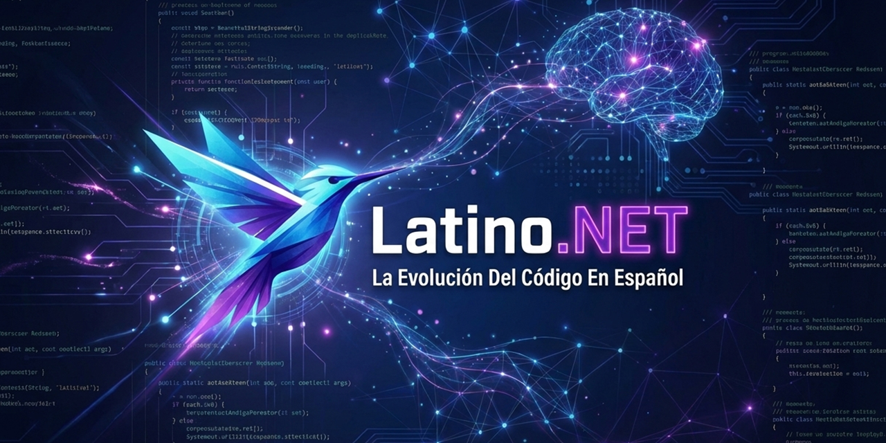

# Latino.NET

[](https://opensource.org/licenses/MIT) [](https://dotnet.microsoft.com/download/dotnet/10.0)



**Latino.NET** es una reimplementación moderna y robusta del lenguaje **Latino**, construida desde cero sobre la solidez del ecosistema **.NET 10**.

A partir de esa sintaxis y filosofía, Latino.NET es un **intérprete Tree-Walker extensible y seguro**, diseñado tanto para el aprendizaje como para tareas reales de **scripting, automatización, ciencias y desarrollo de software**. Su fiabilidad no es teórica: el motor ha sido validado mediante una exhaustiva suite de pruebas unitarias en C# y más de **85 tests de QA de diseño externo bajo condiciones de estrés**, demostrando su capacidad para manejar lógica compleja, concurrencia, gestión de memoria y errores en entornos de producción sin fallos inesperados.

## 🌟 Filosofía y Diseño

El principio rector de Latino.NET es **"Respetar el Pasado, Construir el Futuro"**.

Latino.NET nace de una idea que ya existía: **hacer de la programación en español una experiencia accesible, expresiva y cercana**. Esa idea tiene un nombre: **Latino**.

Para nosotros, Latino es el **lenguaje mentor** de Latino.NET. Su sintaxis, su filosofía y el camino recorrido por su comunidad son el punto de partida sobre el que construimos este proyecto. Sin Latino, Latino.NET no existiría.

Por eso, Latino.NET no pretende reemplazar, corregir ni desmerecer a Latino. **Es un homenaje a esa idea y una evolución técnica de su legado**, construida desde cero sobre .NET para explorar nuevas posibilidades sin perder aquello que nos inspiró.

### 🕰️ Respetar el Pasado

Conservamos los elementos que hacen reconocible y especial la experiencia de programar en Latino:

- La sintaxis natural en español (`si`, `mientras`, `funcion`)
- Las palabras clave (`verdadero`, `falso`, `nulo`)
- La estructura fundamental del lenguaje
- Las convenciones y conceptos que forman parte de su identidad
- Una alta compatibilidad con los programas existentes

Nuestro objetivo es que quienes ya conocen Latino puedan encontrarse con un lenguaje familiar al dar el paso hacia Latino.NET.

### 🚀 Construir el Futuro

Sobre esa base conocida, Latino.NET desarrolla una arquitectura moderna que permite llevar aquella idea a nuevos escenarios.

- **Programación Multiparadigma:** soporte para programación imperativa, orientada a objetos y funcional, integradas de forma nativa dentro del lenguaje.
- **Concurrencia Nativa:** herramientas para trabajar con múltiples hilos, mutex y comunicación mediante canales.
- **Persistencia y Ciencias:** módulos integrados para bases de datos relacionales, matemáticas, ecuaciones y constantes físicas.
- **Interoperabilidad:** sistema de plugins (`.dll`) que permite extender el lenguaje mediante C#, F# o VB.NET y aprovechar el ecosistema de .NET.
- **Robustez:** manejo de errores recuperable, protección frente a desbordamientos de pila y mecanismos de seguridad para escenarios de ejecución complejos.
- **Experiencia de Desarrollador (DX):** autocompletado, formateo inteligente, snippets, diagnósticos y herramientas integradas para Visual Studio Code.
- **Baterías Incluidas:** bibliotecas nativas para matemáticas, archivos, redes, fechas y estructuras de datos.

Estas capacidades no buscan borrar lo anterior, sino **ampliar el camino que Latino abrió**.

Latino.NET mira hacia adelante sin olvidar de dónde viene.

**Respetamos el pasado porque es parte de nuestra historia. Construimos el futuro porque queremos que aquella idea siga viva.**

---

## 🚀 Características Principales

- **Paradigma Multidisciplinar:**
  - **Imperativo:** Estructuras clásicas de control de flujo.
  - **Orientado a Objetos (POO):** Clases, Herencia Top-Down, y Polimorfismo (Duck Typing).
  - **Funcional:** Lambdas, Closures, Orden Superior (`mapear`, `filtrar`, `reducir`) y el potente operador Pipeline (`|>`).
- **Concurrencia Nativa:** Soporte robusto para múltiples hilos, *Mutex* y paso de mensajes por *Canales* (Actor Model) en entornos *Thread-Safe*.
- **Persistencia y Ciencias:** Módulos oficiales integrados para bases de datos relacionales (`sqlite`) y un poderoso solucionador de ecuaciones y constantes físicas (`formulas`).
- **Baterías Incluidas:** Librerías nativas optimizadas para Matemáticas (`mate`), Sistema de Archivos (`archivo`), Redes (`web`), Fechas (`lapsos`) y Estructuras de Datos.

---

## 📥 Descarga e Instalación

### 1. El Compilador (Motor)

Descarga la última versión lista para usar (no requiere instalar .NET) desde la sección de **Releases** o usa los archivos en este repositorio.

#### 🪟 Para Usuarios de Windows

1. 👉 **[Descargar Latino.NET (Windows)](https://github.com/FrkL81/Latino.NET/releases/latest)** - Baja el archivo `latino-win-v1.0.81.zip`.

2. **Descomprimir:** Extrae el contenido del ZIP en una carpeta segura.
   - *Recomendación:* Crea una carpeta llamada `LatinoNET` directamente en tu disco C (ej: `C:\LatinoNET`) y extrae los archivos ahí.

3. **Configuración (El PATH):** Para poder ejecutar el comando `latino` cómodamente desde cualquier terminal, debes agregarlo a las variables de entorno:

   - Presiona la tecla `Windows`, escribe **"Editar las variables de entorno del sistema"** y ábrelo.
   - Haz clic en el botón **"Variables de entorno..."**.
   - En la lista de abajo ("Variables del sistema"), busca la que dice **Path** y selecciónala. Haz clic en **Editar**.
   - Haz clic en **Nuevo** y escribe la ruta de la carpeta donde descomprimiste Latino (ej: `C:\LatinoNET`).
   - Acepta todas las ventanas.

4. **Verificación:** Para que el cambio en las variables de entorno surta efecto, deberás reiniciar el sistema. Luego del reinicio, abre una terminal (CMD o PowerShell) y escribe `latino -v`. Deberías ver la versión instalada.

> **💡 Opción Fácil (Solo VS Code):** Si no quieres configurar el PATH, puedes saltarte el paso 3. Solo asegúrate de recordar dónde guardaste la carpeta para configurar la extensión de VS Code más adelante.

#### 👁️ Configurar el PATH es vital por una sola razón: "Comodidad"

Sin el PATH configurado, para ejecutar un comando o programa de Latino.NET fuera de VS Code tendrás que escribir la ruta completa del ejecutable más el comando o nombre del programa, por ejemplo:

- `C:\LatinoNET\latino.exe C:\ruta\mi_script.lat` 👉🏻 (Lento, tedioso, propenso a errores de dedo).

Con el PATH configurado solo escribes:

- `latino mi_script.lat` 👉🏻 (Rápido, profesional, se siente cómodo).

#### 🐧 Para Usuarios de Linux

1. 👉 **[Descargar Latino.NET (Linux)](https://github.com/FrkL81/Latino.NET/releases/latest)** - Descarga el archivo `latino-linux-v1.0.81.zip`.

2. **Instalación:** Abre tu terminal y ejecuta los siguientes comandos:

   ```bash
      # Navega a la carpeta de descargas (ajusta según tu sistema)
      cd ~/Descargas
      
      # Descomprime el archivo
      unzip latino-linux-v1.0.81.zip
      
      # Mueve el binario a una ruta global
      sudo mv dist/linux/latino /usr/local/bin/
      sudo chmod +x /usr/local/bin/latino
   ```

   > **💡 Alternativa sin sudo:** Si prefieres no usar `sudo`, puedes mover el binario a `~/.local/bin/` (asegúrate de que esta carpeta esté en tu PATH):
   >
   > ```bash
   > mkdir -p ~/.local/bin
   > mv dist/linux/latino ~/.local/bin/
   > chmod +x ~/.local/bin/latino
   > ```

3. **Verificación:** Abre una **nueva terminal** y escribe `latino -v`.

#### 🍎 Para Usuarios de macOS

Debido a las políticas de seguridad de Apple (Gatekeeper), recomendamos compilar tu propia versión nativa para evitar bloqueos de seguridad:

1. Instala el [.NET SDK 10](https://dotnet.microsoft.com/download).

2. Clona este repositorio:

   ```bash
      git clone https://github.com/FrkL81/Latino.NET.git
      cd Latino.NET
   ```

3. Compila según tu procesador:

   **Para Macs con Apple Silicon (M1/M2/M3/M4):**

   ```bash
      dotnet publish src/Latino.App/Latino.App.csproj -c Release -r osx-arm64 --self-contained -o ./bin_mac
   ```

   **Para Macs con procesador Intel:**

   ```bash
      dotnet publish src/Latino.App/Latino.App.csproj -c Release -r osx-x64 --self-contained -o ./bin_mac
   ```

4. **Instalación:** Mueve el binario a una ruta global:

   ```bash
      sudo mv ./bin_mac/latino /usr/local/bin/
      sudo chmod +x /usr/local/bin/latino
   ```

5. **Verificación:** Abre una **nueva terminal** y escribe `latino -v`.

---

### 2. La Extensión (Visual Studio Code)

Para la mejor experiencia, instala el archivo `.vsix` incluido en el lanzamiento (`latino-net-vscode-1.0.81.vsix`) 👉 **[(Extensión Latino.NET)](https://github.com/FrkL81/Latino.NET/releases/latest)** en Visual Studio Code o cualquier fork compatible con sus extensiones: Devin Desktop, Kiro, Antigravity IDE, TRAE, Qoder IDE ...

#### 🔹 Método A: Interfaz Gráfica

1. Abre Visual Studio Code.
2. Ve a la vista de Extensiones (`Ctrl+Shift+X`).
3. Haz clic en el ícono de tres puntos (**...**) en la parte superior derecha del panel.
4. Selecciona **"Instalar desde VSIX..."**.
5. Busca y selecciona el archivo `.vsix` descargado.

#### 🔹 Método B: Terminal

1. Abre una terminal en la carpeta donde está el archivo.
2. Ejecuta: `code --install-extension latino-net-vscode-1.0.81.vsix`

#### ⚙️ Configuración Post-Instalación

Si **NO** configuraste el PATH en el paso anterior (o si VS Code no encuentra el comando `latino`), debes decirle a la extensión dónde está el ejecutable:

1. En VS Code, ve a **Archivo > Preferencias > Configuración**.
2. Busca **Latino**.
3. En la opción **Binary Path**, pega la ruta completa a tu archivo `latino.exe`.
   - *Ejemplo:* `C:\LatinoNET\latino.exe`

## **⚠️ ADVERTENCIA: Conflicto con Latino Clásico**

Si ya tienes instalada la versión clásica de Latino (C), es probable que tu sistema intente ejecutar esa versión en lugar de Latino.NET, ya que ambos utilizan el mismo comando: `latino`.

**Cómo verificar qué versión estás usando:**
Ejecuta: `latino -v`

- Si ves `Latino 1.4.x` -> Estás usando la versión clásica (anterior).
- Si ves `Latino.NET v1.0.81` -> Estás usando la versión nueva (correcta).

**Solución:**

1. **Recomendada:** Desinstala la versión clásica o elimina su ruta de las Variables de Entorno.
2. **Alternativa:** Asegúrate de que la ruta de Latino.NET (`C:\LatinoNET`) esté **arriba (antes)** de la ruta clásica en la lista del PATH.
3. **Renombrado:** Puedes cambiar el nombre de tu nuevo ejecutable a `latinonet.exe` para tener ambas versiones simultáneamente sin conflictos.

### ¿Cómo funciona la distinción?

Si decides renombrar tu archivo `latino.exe` a `latinonet.exe`:

1. **Versión Clásica:** El archivo se llama `latino.exe`.

   - Cuando escribes: `latino hola.lat`
   - Sistema busca: "¿Hay un `latino.exe`? Sí." -> **Ejecuta la clásica.**

2. **Versión .NET (Renombrada):** El archivo se llama `latinonet.exe`.

   - Cuando escribes: `latinonet hola.lat`
   - Sistema busca: "¿Hay un `latinonet.exe`? Sí." -> **Ejecuta versión.NET.**

Al tener nombres de archivo distintos, dejan de pelearse. Pueden vivir en la misma carpeta o en carpetas distintas del PATH, y nunca chocarán.

---

## 💻 Ejemplo de Código

```latino
# IMPORTANTE: Guarda este programa con codificación UTF-8
# para soportar tildes y caracteres especiales.

# Análisis de Transacciones
IVA = 0.15

transacciones = [
    { "id": 1, "monto": 100, "valida": verdadero },
    { "id": 2, "monto": 500, "valida": verdadero },
    { "id": 3, "monto": 0,   "valida": falso }
]

escribir("--- Iniciando Procesamiento ---")

intentar
    # 1. Programación Funcional (Filtrado)
    validas = lista.filtrar(transacciones, funcion(t)
        retornar t["valida"]
    fin)

    # 2. Transformación de datos (Map)
    totales = lista.transformar(validas, funcion(t)
        total = t["monto"] * (1.0 + IVA)
        retornar mate.redondear(total)
    fin)

    # 3. Reporte usando el Compositor 'ç'
    i = 0
    para total en totales
        # Usamos el compositor para incrustar variables limpiamente
        info = ç('Factura #|i|: Total a pagar: $|total|')
        escribir(info)
        i++
    fin

atrapar (error)
    escribir("⚠️ Ocurrió una excepción controlada: " .. error)
fin
```

### **⚡ [Ejemplos Básicos:](ejemplos/)**

Descubre la elegancia de Latino.NET. Código listo para ejecutar, desde un "Hola Mundo" hasta manipulación de archivos.

---

## 📅 Roadmap (Hoja de Ruta)

El desarrollo de Latino.NET sigue una filosofía evolutiva: primero demostramos que funciona, luego hacemos que sea más inteligente y finalmente construimos herramientas profesionales alrededor de él.

### 🧪 Fase 1: Consolidación de la versión pública

El objetivo de esta fase no es añadir grandes funcionalidades, sino convertir la primera versión pública en una base sólida, documentada y confiable para el crecimiento futuro del proyecto.

- **Pruebas profundas de Latino.NET v1.0.81:** validación del lenguaje, librerías estándar, concurrencia, manejo de errores, persistencia y escenarios de uso reales.
- **Corrección de errores reportados:** priorización y resolución de las primeras *issues* encontradas por usuarios durante el uso público.
- **Pruebas de compatibilidad:** verificar el comportamiento de Latino.NET en Windows, Linux y macOS y detectar diferencias específicas de plataforma.
- **Mejora de la documentación:** ampliar ejemplos, aclarar comportamientos, corregir inconsistencias y documentar mejor las características existentes.
- **Mejora de la experiencia inicial:** revisar el proceso actual de descarga, instalación manual y primeros pasos para reducir la fricción de los nuevos usuarios.
- **Ejemplos y casos de uso:** ampliar el conjunto de ejemplos para demostrar capacidades reales del lenguaje y facilitar que nuevos usuarios puedan experimentar rápidamente.
- **Estabilización de la API y librerías:** identificar comportamientos que deban consolidarse antes de introducir cambios importantes en el ecosistema.

### 🧠 Fase 2: Inteligencia y Análisis Semántico

Mejorar la "inteligencia" del editor para detectar errores lógicos mientras se escribe, no solo al ejecutar.

- **Semantic Highlighting Dinámico:** Coloreado de sintaxis basado en el árbol AST del Servidor de Lenguaje en lugar de simples expresiones regulares.
- **Detector de Variables No Definidas:** Subrayado rojo en el editor si intentas usar una variable que no ha sido declarada previamente (evita errores por *typos*).
- **Linter de Expresiones Muertas (No-Op):** Advertencia visual para sentencias que no tienen efecto (ej: `funcion(x)` sin paréntesis o `x + 1` sin asignarlo).
- **Publicación y evolución de la extensión de VS Code:** mejoras de tooling y primeras facilidades de distribución.

### 🔮 Fase 3: Herramientas Profesionales

- **Protocolo de Depuración (DAP):** Implementación de breakpoints, inspección de variables paso a paso y stack traces interactivos directamente integrados en VS Code.
- **AOT Compilation:** Explorar la compilación *Ahead-of-Time* de .NET para generar binarios ultra ligeros a partir de scripts de Latino.NET.
- **Gestor de Paquetes (LPM):** Sentar las bases para un gestor de librerías externo que permita a la comunidad compartir sus propios módulos y plugins `.dll`.

---

## 📚 Documentación

El repositorio incluye el **Manual Oficial**, organizado modularmente. Todo lo expuesto en el manual oficial es 100% soportado:

- **Aprendizaje:**
  - [Introducción](docs/00_Intro.md)
  - [Fundamentos](docs/01_Fundamentos.md)
  - [Control de Flujo](docs/02_Control.md)
  - [Estructuras](docs/03_Estructuras.md)
  - [Funciones y Procedimientos](docs/04_Funciones.md)
  - [Programación Orientada a Objetos (POO)](docs/05_POO.md)
  - [Programación Funcional](docs/06_Programacion_Funcional.md)
  - [Herramientas del Lenguaje](docs/07_Herramientas.md)
  - [Modularidad y Extensibilidad](docs/08_Modulos_Extensibilidad.md)
  - [Más Sintaxis, Errores y Ecosistema](docs/09_Más_Sintaxis_Errores_Lib/09.00_Sintaxis_Errores_Ecosistema.md)
  - [Programación Concurrente](docs/11_Programación_Concurrente.md)
  - [DOP y Persistencia](docs/12_DOP_y_Persistencia.md)
  - [Metaprogramación y Código Dinámico](docs/10_Metaprogramación.md)

- **Referencia:**
  - [Inventario de Librerías Estándar (Resumen)](docs/99_LIBRERIAS_ESTANDAR.md)
  - [Referencia Detallada de API](docs/95_Referencia_API.md)
  - [Referencia de Strings Predefinidos](docs/98_Referencia_Strings_Predefinidos.md)
  - [Referencia de Palabras Reservadas](docs/97_Referencia_Keywords.md)
  - [Referencia de Snippets (VS Code)](docs/96_Referencia_Snippets.md)

- **Avanzado y Comunidad:**
  - [Guía para Crear Plugins en C#](docs/13_Guia_Plugins.md)
  - [Arquitectura Interna del Motor](docs/14_Guia_Arquitectura_Interna.md)
  - [Mantenimiento de la Extensión (VS Code)](docs/15_Mantenimiento_VSCode.md)
  - [Guía de Comunidad y Contribución](docs/16_Guia_Comunidad_Contribucion.md)
  - [Casos de Estudio: Ingeniería Industrial](docs/17_Ingenieria_Industrial.md)
  - [Un Intérprete Rápido (Diseño Core)](docs/18_Un_Intérprete_Rápido.md)
  - [Curiosidades y Mecánicas Ocultas del Motor](docs/19_Curiosidades_del_Lenguaje.md)

---

## ❤️ Créditos y Agradecimientos Especiales

Latino.NET no habría sido posible sin la visión pionera de quienes nos precedieron. Este proyecto es un homenaje y una evolución técnica de ese esfuerzo colectivo.

### Al Legado de Latino

- **Primitivo Roman Montero:** El visionario creador original (2015). Su idea de democratizar la programación mediante el español sembró la semilla que hoy florece en nuestra comunidad.
- **Melvin Guerrero:** El actual guardián del clásico Latino (v1.1+). Su dedicación y mantenimiento constante han mantenido viva la llama y permitido que la comunidad siga creciendo hasta hoy.

De ellos heredamos la sintaxis, la filosofía y, lo más importante, una comunidad interesada en el desarrollo de software con código en español. Latino.NET intenta honrar ese legado llevando la arquitectura del lenguaje a la era moderna con .NET, para que el sueño de un lenguaje hispano siga siendo relevante y potente en la industria del futuro.

#### Del Equipo Actual (Latino.NET)

Desarrollado con ❤️ utilizando .NET 10 para ofrecer robustez y estabilidad de nivel empresarial.

---

## ☕ ¿Te resulta útil Latino.NET?

Latino.NET es software libre y seguirá siéndolo.

Si te ha ayudado a aprender, automatizar una tarea, recuperar el gusto por programar en español o simplemente te parece un proyecto que vale la pena mantener, **puedes ayudarnos a seguir construyéndolo**.

Tu apoyo contribuye directamente a mantener y hacer crecer el proyecto:

- 🛠️ **Desarrollo:** nuevas funcionalidades, mejoras del lenguaje y correcciones.
- 🧪 **Calidad:** pruebas, estabilidad y compatibilidad entre plataformas.
- 📚 **Documentación:** ejemplos, tutoriales y material para aprender.
- 🧩 **Ecosistema:** herramientas, extensiones y bibliotecas alrededor de Latino.NET.
- 🚀 **Continuidad:** tiempo y recursos para que el proyecto pueda seguir avanzando.

### Tu apoyo no compra funciones

Latino.NET **no tiene funciones bloqueadas detrás de un pago**. No necesitas patrocinar el proyecto para utilizarlo, aprender con él o contribuir a su código.

El proyecto es libre y abierto. **Tu apoyo simplemente nos ayuda a dedicar más tiempo y recursos a construirlo.**

Si Latino.NET te ha ahorrado tiempo, te ha enseñado algo o te ha servido para resolver un problema, considera invitarnos un café.

- **Cada café ayuda a convertir este proyecto en más código. ☕**

[](https://frkl81.gumroad.com/l/LatinoNET)

> **¿No puedes aportar dinero? No pasa nada.**  
> Una estrella ⭐, un issue bien explicado, una contribución de código, documentación o simplemente compartir Latino.NET también ayuda muchísimo.

---

## 🤝 Contribuir

Este proyecto es Open Source.

- Lee nuestro **Código de Conducta** en la Guía de Comunidad y Contribución antes de participar.
- Si deseas formar parte del equipo central, consulta la sección: **Convertirse en Mantenedor**.

  - ℹ️ **[Guía de Comunidad y Contribución](docs/16_Guia_Comunidad_Contribucion.md)**.

- 🐛 **[Reportar un Error](https://github.com/FrkL81/Latino.NET/issues)**: Si encuentras un fallo en la extensión o el lenguaje, por favor repórtalo en GitHub.

¡Esperamos ver lo que construyes con Latino.NET!

---
