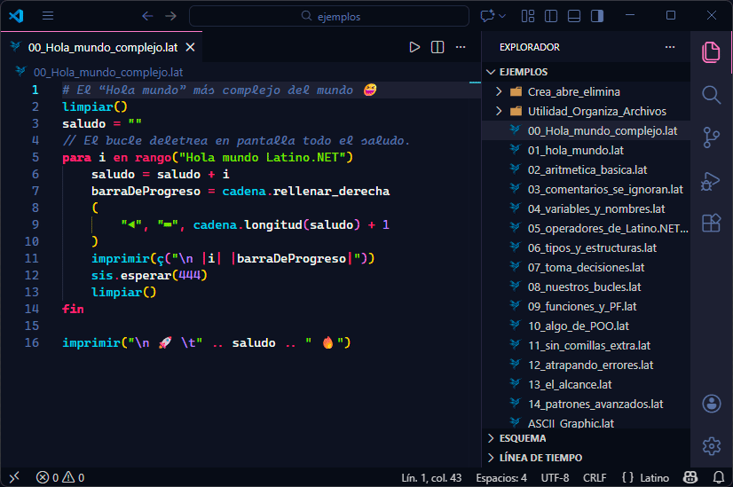
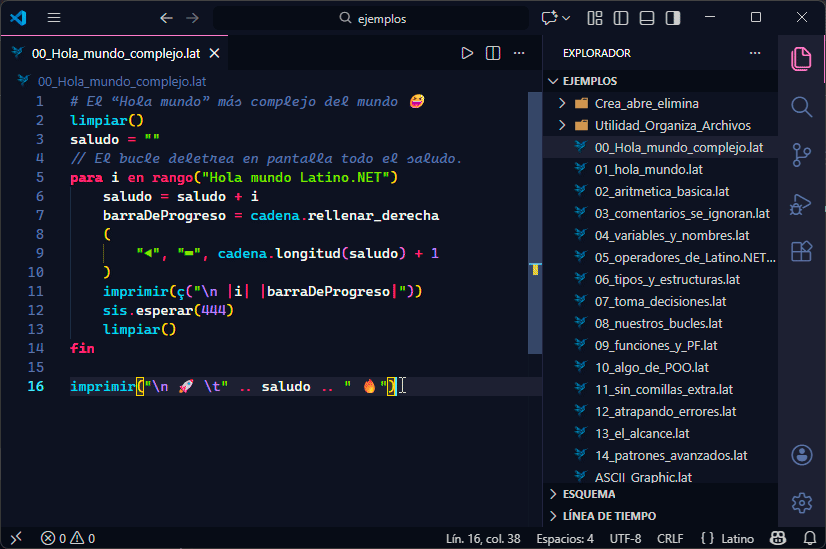
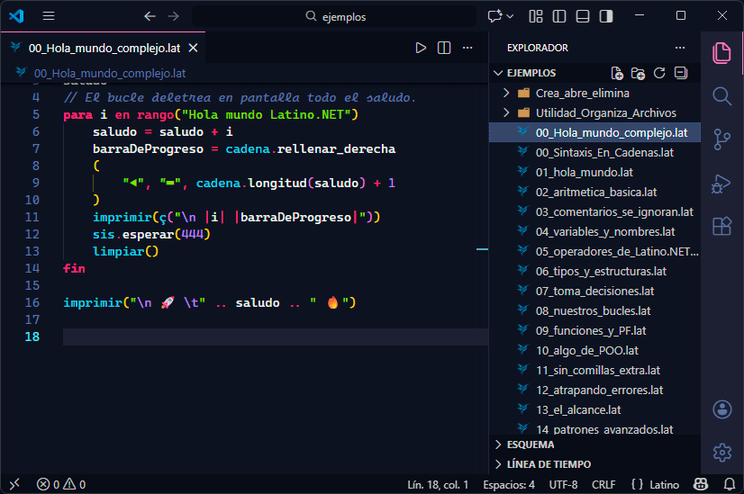
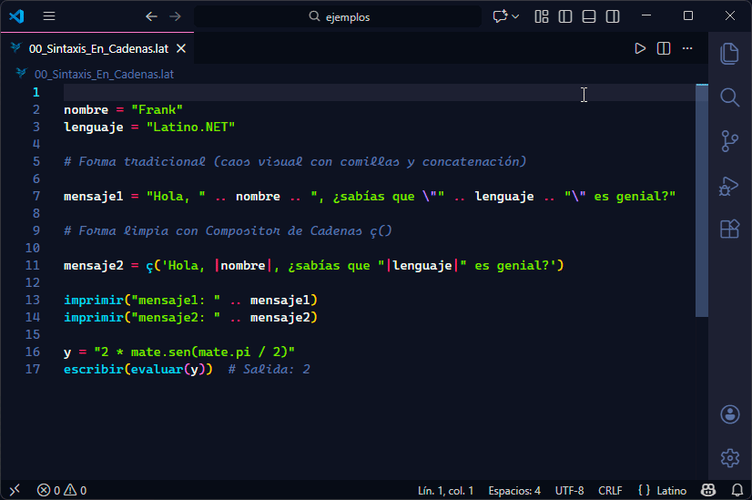
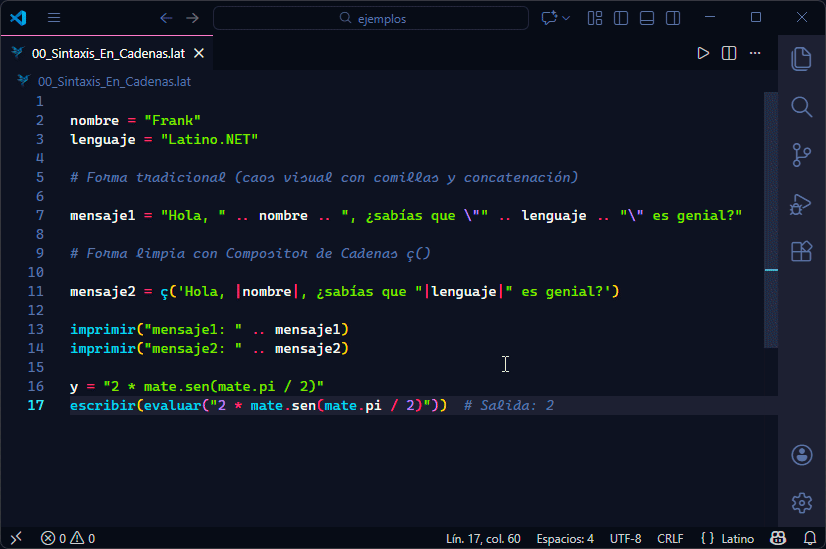
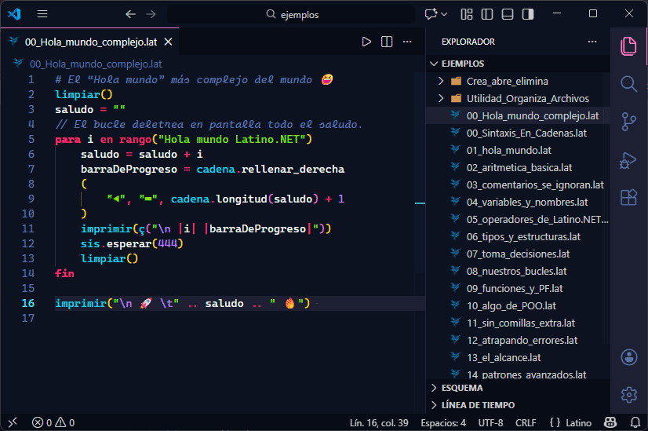
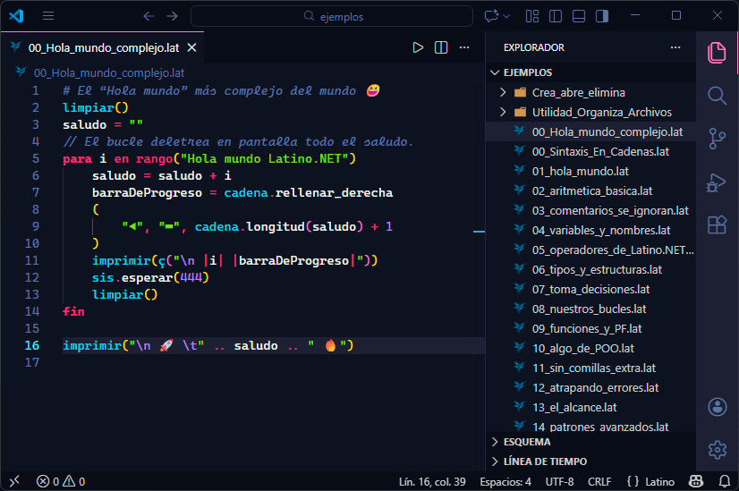
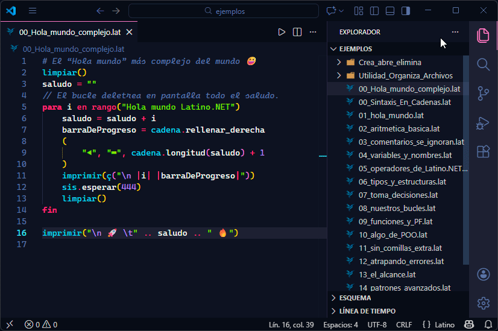

# Extensión Latino.NET para VS Code

  

Soporte oficial para el lenguaje de programación **Latino.NET**.
Proporciona resaltado de sintaxis, detección de errores, autocompletado inteligente y ejecución integrada.

---

## 📋 Prerrequisitos

Esta extensión requiere el motor (compilador) de Latino.NET instalado en tu sistema para funcionar.

👉 **[Descargar Latino.NET (Windows / Linux)](https://github.com/FrkL81/Latino.NET/releases/latest)**

---

## 🚀 Características

### 🧠 IntelliSense (Autocompletado y Ayuda)

El editor "sabe" qué funciones existen en el ecosistema. Escribe `mate.` o `sis.` para ver las opciones, y pasa el mouse sobre ellas para ver la documentación en tiempo real.

Además, el LSP incluye características de grado industrial:

- **Escaneo de Plugins:** Si usas `incluir("sqlite")` o `incluir("formulas")`, el editor inyectará dinámicamente las funciones del plugin en el autocompletado global.
- **Renderizado Matemático:** Las descripciones del plugin científico (`formulas`) se renderizan usando Unicode matemático hermoso y universal directamente en los tooltips.

### ✨ Magic Strings (Autocompletado en Cadenas)

A partir de la versión **1.0.81+**, la extensión cuenta con un **Proveedor de Strings Predefinidos**.
Cuando el cursor está dentro de comillas (`""` o `''`), escribe el carácter `@` para ver sugerencias automáticas de unidades, formatos, hashes y estilos de cadena válidos para el motor.

- Prueba escribir `@estilo:` o `@unidad:` dentro de una cadena.

### ⚡ Snippets y Estructuras

Guía completa de los snippets integrados en la extensión VS Code de Latino.NET v1.0.81.

> **⚠️ Nota Importante:** Esta extensión sigue una regla de diseño estricta: **"No competir con el Autocompletado"**. Las funciones simples de las librerías (como `cadena.estilo()`, `mate.abs()`, `lista.agregar()`) ya están disponibles dinámicamente mediante el **Language Server** y no requieren snippets.
> Nuestra lista contiene exclusivamente **fragmentos estructurales y patrones de diseño avanzados**.

## 🗂️ Organización por Categorías

Los snippets usan prefijos jerárquicos para agruparse por funcionalidad:

| 👁️ | Categoría | Prefijo | Descripción |
| -- | --------- | ------- | ----------- |
| ❓ | **Condicionales** | `cond:*` | Bloques si-osi-sino, operador ternario |
| 🔁 | **Bucles** | `loop:*` | Mientras, para, desde, repetir, rango |
| ⚙️ | **Funciones** | `fn:*` | Declaraciones de funciones estándar |
| 🎯 | **POO** | `poo:*` | Clases, herencia, clases base (preparadas para Auto-Chaining) |
| ⚠️ | **Errores** | `err:*` | Bloques de intentar-atrapar y validación |
| 🔧 | **Avanzadas** | `adv:*` | Mapear, filtrar, reducir (Programación Funcional) |
| 💬 | **I/O** | `io:*` | Formatos .NET/C, compositor, validación de entrada |
| 📁 | **Archivos** | `file:*` | Lectura segura, JSON, procesamiento de líneas |
| 🔧 | **Utilidades** | `util:*` | Validación de tipos, cronómetro, emails, contraseñas |
| 🌐 | **Web** | `web:*` | Peticiones HTTP GET y descarga de archivos |
| 📋 | **Plantillas** | `tpl:*` | Estructuras base de programas completos |
| ⚡ | **Operadores** | `op:*` | Operadores especiales (`ý`, `ó`, incremento) |
| 🎨 | **Sintaxis Alternativa** | `syntax:*` | **(¡NUEVO!)** Patrones complejos: Pipeline (`\|>`), Lambdas, Fusión Nula (`??=`), Omni-Solvers, Clausuras y Diccionarios Alineados. |

Escribe código más rápido usando atajos. Prueba escribir `syntax:` o `poo:`, selecciona un fragmento y presiona **Tab**.

### 🎨 Sintaxis Dentro De Cadenas Para `ç()` y `evaluar()`

Coloreado completo de sintaxis, incluyendo soporte visual para el **Compositor de Cadenas**: `ç("Hola |variable|")` y la **Función evaluar**: `evaluar("2 * mate.sen(mate.pi / 2)")`

### ▶️ Ejecución y Diagnóstico

Detecta errores de sintaxis (subrayado rojo) mientras escribes. Ejecuta tu código con un solo clic usando el botón **Play** en la barra de título.

## 🏗️ Generador de Proyectos y Archivos (Scaffolding)

La extensión incluye comandos nativos para generar estructuras de código al instante. Además, usar estos comandos **garantiza que los archivos se creen con codificación UTF-8 nativa**, evitando problemas de caracteres corruptos (tildes y emojis) en Windows.

Abre la Paleta de Comandos (`Ctrl+Shift+P`) y escribe **Latino: Nuevo**:

- **Nuevo archivo vacío:** Crea un script `.lat` en blanco.
- **Nuevo módulo simple:** Crea un archivo con el patrón *Factory* recomendado para librerías.
- **Nuevo módulo de clases:** Genera un esqueleto de Programación Orientada a Objetos.
- **Nuevo proyecto CRUD CLI:** Despliega un sistema completo conectado a SQLite.
- **Nuevo Proyecto Profesional:** Genera la arquitectura oficial de carpetas (`lib/`, `clases/`, `datos/`, `docs/`) y un archivo `inicio.lat`.

## ⌨️ Atajos de Teclado: *¡El Easter Egg Hispano!*

Para crear un nuevo archivo vacío a la velocidad de la luz, presiona **`Ctrl + Alt + Ñ`** (`Cmd + Option + Ñ` en Mac).

> **💡 Nota Técnica:** Al mirar tus atajos en VS Code, verás que este atajo aparece registrado como `ctrl+alt+oem_3`. Esto es completamente intencional: `oem_3` es el código de hardware universal para la tecla `Ñ` en los teclados hispanos. ¡Es nuestro sello de identidad! Si tu teclado está en inglés o prefieres usar otra tecla, puedes remapearlo fácilmente buscando `latino.newFile` en tus Atajos de Teclado (`Ctrl+K Ctrl+S`).

---

## 🎨 Temas Visuales Optimizados

La extensión incluye **dos temas profesionales** diseñados específicamente para Latino:

### 🌙 Latino.NET Dark

- **Fondo:** `#161925` (Azul Abismo)
- **Sintaxis:** Paleta inspirada en Dracula con ajustes para Latino
- **Ideal para:** Trabajo nocturno, sesiones largas de programación

### ☀️ Latino.NET Light  

- **Fondo:** `#FFFFFF` (Blanco puro)
- **Sintaxis:** Alto contraste optimizado para lectura
- **Ideal para:** Trabajo diurno, presentaciones, documentación

**Activar tema:**

1. `Ctrl+K Ctrl+T` (Windows/Linux) o `Cmd+K Cmd+T` (Mac)
2. Buscar "Latino.NET Dark" o "Latino.NET Light"
3. Seleccionar

---

## 📁 Plegado de Código (Code Folding)

Desde la versión 1.0.81+, **todos los bloques** se pueden plegar:

### Bloques Soportados Para Plegado

**Atajos de teclado:**

- `Ctrl+Shift+[` - Plegar bloque actual
- `Ctrl+Shift+]` - Desplegar bloque actual
- `Ctrl+K Ctrl+0` - Plegar todo
- `Ctrl+K Ctrl+J` - Desplegar todo

### Estructuras que se Pliegan

✅ Funciones (`funcion` ... `fin`)  
✅ Clases (`clase` ... `fin`)  
✅ Condicionales (`si` ... `fin`)  
✅ Bucles (`mientras`, `para`, `repetir` ... `fin`/`hasta`)  
✅ Switch (`elegir` ... `fin`)  
✅ Try-Catch (`intentar` ... `fin`)  

---

## ⚙️ Configuración

Si el comando `latino` no está en tu PATH global (o si usas una instalación portable), debes configurar la ruta manualmente para habilitar la ejecución y la introspección de plugins:

1. Ve a **Archivo > Preferencias > Configuración** (`Ctrl + ,`).
2. Busca **Latino**.
3. En **Binary Path**, pega la ruta completa a tu ejecutable:
    - *Ejemplo Windows:* `C:\LatinoNET\latino.exe`
    - *Ejemplo Linux/Mac:* `/usr/local/bin/latino`

> 💡 **¿Por qué es importante configurar Binary Path?**  
> Además de habilitar el botón **Play (Ejecutar)**, esta ruta le indica al Servidor de Lenguaje (LSP) dónde encontrar la carpeta `lib/` con los plugins oficiales (`sqlite.dll`, `lapsos.dll`, `formulas.dll`). Sin esta configuración, el editor solo podrá ofrecer autocompletado y ayuda visual (*hover*) de plugins si las DLLs se encuentran copiadas en la misma carpeta de tu proyecto.

---

## ⚠️ Notas Importantes

- **Codificación (Emojis y Tildes):** Para que Latino.NET muestre correctamente tildes, ñ y emojis, el archivo debe guardarse con codificación **UTF-8**.

>*Verificación:* Mira la barra inferior derecha de VS Code. Si dice "Windows-1252" o "ISO-8859-1", haz clic ahí y selecciona **"Save with Encoding" -> "UTF-8"**.

- ⚠️ ADVERTENCIA: Esta extensión no es compatible con Latino Clásico.

---

## 📚 Recursos y Ayuda

- 📘 **[Manual Oficial del Programador](docs/)**: Brinda guías paso a paso y explicaciones detalladas para que los programadores puedan crear, mantener y optimizar proyectos en el ecosistema de Latino.NET.

- **⚡ [Ejemplos Básicos](ejemplos/)**: Tu punto de partida. Scripts funcionales y claros para aprender la sintaxis y los conceptos del lenguaje paso a paso.

- 🐛 **[Reportar un Error](https://github.com/FrkL81/Latino.NET/issues)**: Si encuentras un fallo en la extensión o el lenguaje, por favor repórtalo en GitHub.

- 💻 **[Código Fuente](https://github.com/FrkL81/Latino.NET)**: Repositorio principal del proyecto.

---
